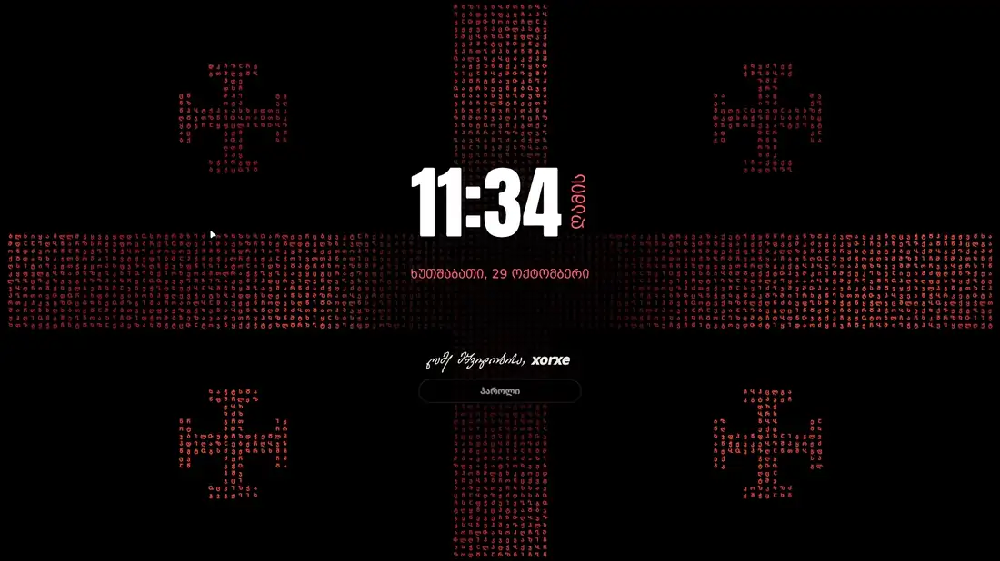

<div align="center">


# ფარნავოსი · Pharnavos

*ყველაზე ნაკლებად პატრიოტული ქართული ყინჩი*

**ქართული სამუშაო გარემო Hyprland-ისთვის: Quickshell-ზე აწყობილი და NixOS-ისთვის შეფუთული.**

**ქართული** · [English](README.en.md)

<a href="https://nixos.org"></a>
<a href="https://hyprland.org"></a>
<a href="https://quickshell.org"></a>
<a href="LICENSE"></a>

[ნახვა](#ნახვა) · [რა არის შიგნით](#რა-არის-შიგნით) · [დაყენება](#დაყენება) · [კლავიშები](#კლავიშები) · [მოირგე](#მოირგე) · [ავტორები და ლიცენზია](#ავტორები-და-ლიცენზია)

</div>

## ნახვა

<div align="center">
  <a href="docs/showcase.mp4"></a>
  <br><sub>ჩაკეტვის ეკრანები, სამი ფონი, მართვის ცენტრი და გამშვები (1.5× სისწრაფით). დააჭირე სრული ხარისხის ვიდეოსთვის.</sub>
</div>

<br>

> **ავტორის შენიშვნა**
>
> ეს ჩემი პირადი სამუშაო გარემოა. ისე შევფუთე, რომ ნებისმიერმა შეძლოს დაყენება, მაგრამ ის ჩემთვის
> გაკეთდა: ჩემი მუშაობის წესზე და ჩემს გემოვნებაზე. თამამად დაშალე და შენს საჭიროებებს მოარგე: ეს
> თავისუფალი პროგრამაა (GPL-3.0) და თითქმის ყველაფერი ნაგულისხმევი მნიშვნელობაა, რომელსაც შენი
> კონფიგურაციიდან შეცვლი.

## რა არის შიგნით

| ნაწილი | რას აკეთებს |
|---|---|
| **პანელი** | ნახევრად ჩაძირული ბორჯღალი მუსიკის სხივებით, ჯვრული ნაქარგის რომბები სამუშაო სივრცეებისთვის, ცოცხალი Wi-Fi / Bluetooth / ხმის / ენერგიის ხატულები |
| **გამშვები** | აპების ძებნა ქართული ტრანსლიტერაციით, კალკულატორი, ბრძანებები, ღია ფანჯრები, ვებში ძებნა, სურვილისამებრ AI-სთვის კითხვა და თარგმნა |
| **მართვის ცენტრი** | Wi-Fi პაროლის შეყვანით, Bluetooth, ხმა, კალენდარი, საქმეების სია, გამორთვა / გადატვირთვა, ფონისა და ჩაკეტვის ეკრანის პარამეტრები |
| **შეტყობინებები** | ნაქარგი ამომხტარი ბარათები და შეტყობინებების ცენტრი დაჯგუფებით |
| **OSD** | ხმა — ყანწი, რომელიც ხმის ტალღებს უბერავს; სიკაშკაშე — მზე, რომელიც ჰორიზონტზე ამოდის |
| **ფონები** | რუსთაველის სტრიქონები ბორჯღალის სპირალზე, ვაჟა-ფშაველას პორტრეტი მისივე ლექსებით და, სურვილისამებრ, მოცეკვავე მოციმციმე ასოებისგან |
| **ჩაკეტვის ეკრანები** | წმ. გიორგი, ხუთჯვრიანი დროშა ან მბრუნავი ბორჯღალი — ყველა მოციმციმე ქართული ასოებით |
| **დახურვის ეფექტი** | დახურვისას ფანჯრები ქართულ ასოებად იშლება |

ყველაფერი ნაგულისხმევად ქართულად არის და ერთი დაჭერით ინგლისურზე გადადის; ინგლისურად ფონზე
უორდროპის რუსთაველი და ჰიუიტის ვაჟა-ფშაველა იკითხება.

## დაყენება

> [!NOTE]
> დაგჭირდება NixOS flake-ებით და home-manager. ფარნავოსი მუშაობს **NixOS 26.05**-ზე (Hyprland 0.55,
> hyprlang კონფიგურაცია) და **nixos-unstable**-ზე (Hyprland 0.56+, Lua კონფიგურაცია: დააყენე
> `wayland.windowManager.hyprland.configType = "lua";`).

<details>
<summary><b>ახალ NixOS-ზე</b></summary>

<br>

1. დააყენე NixOS 26.05 მინიმალური ISO-დან ჩვეულებრივად, `nixos-generate-config --root /mnt`-ის
   ჩათვლით.
2. შექმენი კონფიგურაცია შაბლონიდან, დაგენერირებული hardware-კონფიგურაციის გვერდით:
   ```sh
   cd /mnt/etc/nixos
   nix --extra-experimental-features 'nix-command flakes' flake init -t github:xor-xe/Pharnavos
   ```
   ეს დაამატებს `flake.nix`-ს, `configuration.nix`-სა და `home.nix`-ს და შენს
   `hardware-configuration.nix`-ს ხელუხლებლად დატოვებს. **nixos-unstable**-ზე გამოიყენე unstable
   შაბლონი — იგივე სისტემა, ყველა კლავიშით Lua-ში:
   ```sh
   nix --extra-experimental-features 'nix-command flakes' flake init -t github:xor-xe/Pharnavos#unstable
   ```
3. შეცვალე ჩანაცვლების ადგილები:
   - `flake.nix`: `user = "me";` → შენი მომხმარებლის სახელი
   - `configuration.nix`: კომპიუტერის სახელი, დროის სარტყელი, ჩამტვირთავი, თუ UEFI-ს არ იყენებ
   - `home.nix`: შენი კლავიშები, მონიტორები, პაკეტები
4. დააყენე და გადატვირთე:
   ```sh
   nixos-install --flake /mnt/etc/nixos#pharnavos
   nixos-enter --root /mnt -c 'passwd <your-user>'
   reboot
   ```
5. შედი სისტემაში; Hyprland ფარნავოსით ჩაირთვება. `Super`+`R` ხსნის გამშვებს, პანელის მარჯვენა
   ბოლოში ჯვარი — მართვის ცენტრს.

შემდეგში ხელახლა აწყობა: `sudo nixos-rebuild switch --flake /etc/nixos#pharnavos`.

</details>

<details>
<summary><b>არსებულ NixOS flake-ში</b></summary>

<br>

1. დაამატე input:
   ```nix
   inputs.pharnavos = {
     url = "github:xor-xe/Pharnavos";
     inputs.nixpkgs.follows = "nixpkgs";
   };
   ```
2. სისტემა (არასავალდებულო, მაგრამ რთავს იმას, რასაც გარემო იყენებს: Hyprland, PipeWire,
   NetworkManager, Bluetooth, ენერგიის პროფილები, hyprlock; ყველა — ნაგულისხმევად, შეცვლადი):
   ```nix
   nixosConfigurations.<host> = nixpkgs.lib.nixosSystem {
     modules = [ ./configuration.nix pharnavos.nixosModules.default ];
   };
   # configuration.nix
   programs.pharnavos.enable = true;
   ```
3. home-manager (NixOS მოდულად ან დამოუკიდებლად, ერთი და იგივე მოდული):
   ```nix
   home-manager.users.<you>.imports = [ pharnavos.homeModules.default ];
   # home.nix
   programs.pharnavos.enable = true;
   wayland.windowManager.hyprland.enable = true;   # ფარნავოსი შენს Hyprland კონფიგურაციას ემატება
   ```
4. ხელახლა ააწყვე. ფარნავოსი systemd-ის მომხმარებლის სერვისად `pharnavos.service` ეშვება შენს
   Hyprland სესიასთან ერთად (`systemctl --user status pharnavos`).

ფარნავოსი თავადაა პანელი, ფონი და შეტყობინებების სერვისი, ამიტომ აწყობა გაჩერდება გასაგები
შეტყობინებით, თუ ჩართულია Waybar, eww, HyprPanel, swww / awww, hyprpaper, wpaperd, mako, dunst ან
swaync, და გაგაფრთხილებს, თუ რომელიმე მათგანი Hyprland-ის ავტოგაშვებიდან ირთვება.

</details>

<details>
<summary><b>რა დაყენდება</b></summary>

<br>

არაფერი დაყენდება და არაფერი შეიცვლება, სანამ თვითონ არ ჩართავ:

| რასაც რთავ | რას ამატებს |
|---|---|
| `programs.pharnavos.enable` (home-manager) | თავად გარემოს (`pharnavos`, `pharnavos-lock`), მის ხელსაწყოებს (Quickshell, cava, nmcli, nm-connection-editor, blueman, powerprofilesctl, curl, pdftotext, hyprlock), Noto და FiraCode შრიფტებს, `pharnavos` სერვისს; Hyprland-ის კლავიშებს, ფანჯრების იერსახეს და ჩაკეტვის აღდგენას (`hyprland.enable`); hypridle-ით ჩაკეტვას (`lock.enable`) |
| `programs.pharnavos.enable` (NixOS) | Hyprland, PipeWire, NetworkManager, Bluetooth + blueman, power-profiles-daemon (თუ არ დააყენე `powerProfiles = false`, მაგალითად TLP-ის გამო), hyprlock (ყველა ნაგულისხმევად) |
| `programs.pharnavos.ai.enable` (home-manager) | მხოლოდ გამშვების `?` / `#`; ესაუბრება შენ მიერ არჩეულ მოდელის სერვერს და არაფერს აყენებს |
| `programs.pharnavos.ai.ollama.enable` (NixOS) | **ollama**-ს სისტემურ სერვისად და პირველ გაშვებაზე ჩამოტვირთავს ჩამოთვლილ მოდელებს (**რამდენიმე GB**; სასურველია GPU) |

შაბლონი (ახალი დაყენება) ასევე ამატებს greetd + tuigreet-ს, foot-ს, Firefox-ს, git-სა და kew-ს
(ტერმინალის მუსიკის დამკვრელი `~/Music`-ისთვის).

</details>

## კლავიშები

| კლავიშები | მოქმედება |
|---|---|
| `Super` + `R` | გამშვების გახსნა / დახურვა |
| `Super` + `W` / `Shift` + `W` | შემდეგი / წინა ფონი |
| `Super` + `L` | ეკრანის ჩაკეტვა |
| `Super` + `Enter` | ტერმინალი (foot) |
| `Super` + `Q` | ფანჯრის დახურვა |
| `Super` + `1` … `9` | სამუშაო სივრცე 1–9 (`Shift`-ით: ფანჯრის იქ გადატანა) |
| `Alt` + `Shift` | კლავიატურის ენა (ინგლისური ⇄ ქართული) |

<details>
<summary><b>ყველა კლავიში</b></summary>

<br>

**Hyprland** (`Super` = Windows-ის კლავიში). გამშვების, ფონისა და ჩაკეტვის კლავიშები ფარნავოსისაა
(`programs.pharnavos.hyprland.launcherKey` / `wallpaperKey` / `lockKey`); დანარჩენი შაბლონების
`home.nix`-შია, ასე რომ, არსებულ კონფიგურაციაზე შენი კლავიშები გრჩება.

| კლავიშები | მოქმედება |
|---|---|
| `Super` + `R` | გამშვების გახსნა / დახურვა |
| `Super` + `W` / `Shift` + `W` | შემდეგი / წინა ფონი |
| `Super` + `L` | ეკრანის ჩაკეტვა |
| `Super` + `Enter` | ტერმინალი (foot) |
| `Super` + `Q` | ფანჯრის დახურვა |
| `Super` + `F` | მთელ ეკრანზე |
| `Super` + `V` | ფანჯრის მოცურება / დაწყობა |
| `Super` + `1` … `9` | სამუშაო სივრცე 1–9 |
| `Super` + `Shift` + `1` … `9` | ფანჯრის გადატანა სამუშაო სივრცეზე 1–9 |
| `Super` + მარცხენა / მარჯვენა გადათრევა | ფანჯრის გადაადგილება / ზომის შეცვლა |
| `Alt` + `Shift` | კლავიატურის ენა (ინგლისური ⇄ ქართული) |
| ხმის კლავიშები | ხმის აწევა / დაწევა / დადუმება (ხმის OSD-ით) |

**გამშვები**

| კლავიშები | მოქმედება |
|---|---|
| აკრეფა | აპების ძებნა (ქართულად აკრეფილი ლათინურ სახელებსაც პოულობს) |
| `↑` / `↓`, მაუსის ბორბალი | არჩევანის გადაადგილება |
| `Enter` | გაშვება / შესრულება / დაკოპირება (რეჟიმის მიხედვით) |
| `Alt` + `1` … `8` | მიმაგრებული აპის გაშვება |
| `Esc` | ტექსტის წაშლა, შემდეგ დახურვა |
| `=` 2+2 | კალკულატორი (`Enter` აკოპირებს პასუხს) |
| `>` ბრძანება | ბრძანების შესრულება მცურავ ტერმინალში |
| `@` სახელი | ღია ფანჯარაზე გადასვლა |
| `!` სიტყვები | ვებში ძებნა |
| `?` კითხვა | AI მოდელისთვის კითხვა (მხოლოდ `programs.pharnavos.ai`-ით) |
| `#` ტექსტი | თარგმნა ქართ ⇄ ინგლ (მხოლოდ `programs.pharnavos.ai`-ით) |

**პანელი, ფანჯრები, ჩაკეტვის ეკრანი**

| სად | მოქმედება |
|---|---|
| ჯვარი (პანელის მარჯვენა ბოლო) | მართვის ცენტრი; `Esc` ხურავს |
| ზარი | შეტყობინებების ცენტრი; `Esc` ხურავს |
| მზე პანელის შუაში | მუსიკის დაკვრა / პაუზა |
| `EN` / `KA` ნიშანი | კლავიატურის ენის შეცვლა |
| Wi-Fi ხატულა | რკალები = სიგნალი (წითელი = კავშირი არ არის); მიტანა = ჩამოტვირთვის / ატვირთვის სიჩქარე; დაჭერა = ქსელის პარამეტრები |
| Bluetooth ხატულა | წითელი წერტილი = მოწყობილობა მიერთებულია; მიტანა = მოწყობილობები და ბატარეა; დაჭერა = Bluetooth-ის მართვა |
| ხმის ხატულა | დაჭერა = დადუმება, ბორბალი = ხმა |
| ენერგიის საზომი | ისარი = პროფილი (მარცხნივ დაზოგვა, ზემოთ ბალანსი, მარჯვნივ მარდად); დაჭერა = შემდეგი პროფილი |
| სამუშაო სივრცის რომბები | დაჭერა = სივრცეზე გადასვლა |
| ამომხტარი შეტყობინება | დაჭერა = დახურვა, მარჯვენა დაჭერა = მის აპში გახსნა |
| შეტყობინება ზარში | დაჭერა = გახსნა, მარჯვენა დაჭერა = დახურვა (ჯგუფთან ერთად) |
| მართვის ცენტრი: Wi-Fi / Bluetooth | დაჭერა = სიის გახსნა, ხანგრძლივი დაჭერა = ჩართვა / გამორთვა |
| მართვის ცენტრი: საქმეების სია | აკრეფა + `Enter` ამატებს, მარჯვენა დაჭერა შლის |
| ჩაკეტვის ეკრანი | პაროლი + `Enter`; `Esc` შლის |

</details>

## მოირგე

ფარნავოსი იმისთვისაა, რომ შენს გემოზე მოირგო. შენი პაკეტები და კონფიგურაცია შენია: ის შენი
flake-ის ერთი input-ია და შენს ფაილებში არასდროს წერს.

- **პარამეტრები მართვის ცენტრში.** ენა, ფონი და მისი ტექსტი, ანიმაცია, ფერები, წითელი ფონი,
  ჩაკეტვის ეკრანის იერსახე და საათის ფორმატი მართვის ცენტრიდან იცვლება და ინახება
  `~/.local/state/pharnavos/settings.json`-ში.
- **ფანჯრების იერსახე ნაგულისხმევია.** რასაც `wayland.windowManager.hyprland.settings`-ში
  დააყენებ, ის იმარჯვებს, მაგალითად `general.border_size = 3;`. მთლიანად გამორთვა:
  `programs.pharnavos.hyprland.enable = false;`, შემდეგ კი თვითონ ააწყვე.
- **Hypridle**-ის პარამეტრებიც ნაგულისხმევია: ჩაანაცვლე `services.hypridle.settings`-ით, ან
  `programs.pharnavos.lock.enable = false;`. შენს hypridle-ში ჩაკეტე
  `lock_cmd = config.programs.pharnavos.lockCommand;`-ით, რომ ჩაკეტვის ეკრანმა შენი ენა, სახელი და
  შრიფტები მიიღოს.
- **შენი შრიფტები, სახელი და კლავიშები** — ქვემოთ მოცემული პარამეტრებით.
- **თავად გარემოს შეცვლა.** ის ჩვეულებრივი QML-ია `shell/`-ში. გააკეთე fork, შენი flake-ის input
  შენს fork-ზე მიმართე (ან ადგილობრივ ასლზე, `url = "git+file:///home/you/Pharnavos";`) და შეცვალე,
  რაც გინდა.

<details>
<summary><b>პარამეტრები</b></summary>

<br>

```nix
programs.pharnavos = {
  enable = true;
  language = "ka";                 # "ka" (ქართული, ნაგულისხმევი) ან "en"; მართვის ცენტრშიც იცვლება
  name = "ხორხე";                  # მისალმების სახელი; ნაგულისხმევად შენი მომხმარებლის სახელი
  terminal = "foot";               # გამშვების `>`-ისა და ტერმინალის აპებისთვის (-e უნდა მიიღოს)
  fonts.heading = ./my-font.ttf;   # შენი შრიფტები (ნაგულისხმევად FiraGO / BPG Excelsior Caps)
  fonts.label = null;
  powerProfiles = true;            # ენერგიის საზომი პანელზე (NixOS-შიც: power-profiles-daemon)
  wallpaper.dance = null;          # საქაღალდე dance.png + dance.json-ით: ამატებს ცეკვის ფონს
  hyprland.enable = true;          # კლავიშები, ფანჯრების იერსახე, ჩაკეტვის აღდგენა
  hyprland.launcherKey = "SUPER, R";
  hyprland.wallpaperKey = "SUPER, W";   # Shift-ით: წინა ფონი
  hyprland.lockKey = "SUPER, L";
  lock.enable = true;              # hypridle + ფარნავოსის ჩაკეტვის ეკრანი
  lock.idleMinutes = 15;
  lock.screenOffMinutes = 20;
};
```

</details>

<details>
<summary><b>AI გამშვებში (არასავალდებულო)</b></summary>

<br>

ნაგულისხმევად გამორთულია. ჩართვისას გამშვებს ემატება `?` (მოდელისთვის კითხვა) და `#` (თარგმნა
ქართ ⇄ ინგლ); გამორთვისას ეს პრეფიქსები არ არსებობს.

**ადგილობრივად, ollama-თი** (კომპიუტერიდან არაფერი გადის). NixOS:

```nix
programs.pharnavos.ai.ollama = {
  enable = true;
  models = [ "llama3.2:3b" ];      # ~2 GB; დიდი მოდელები უკეთ პასუხობს და მეტ მეხსიერებას ითხოვს
  package = pkgs.ollama-cuda;      # NVIDIA; AMD-სთვის pkgs.ollama-rocm; pkgs.ollama = მხოლოდ CPU
};
```

home-manager:

```nix
programs.pharnavos.ai = {
  enable = true;
  model = "llama3.2:3b";
  # translateModel = "translategemma:27b";   # არასავალდებულო, ცალკე მთარგმნელი მოდელი
};
```

**ნებისმიერი სხვა სერვერი** OpenAI-თავსებადი API-ით (LM Studio, llama.cpp, vLLM, OpenRouter,
OpenAI, …):

```nix
programs.pharnavos.ai = {
  enable = true;
  api = "openai";
  url = "http://localhost:1234/v1";          # ან https://openrouter.ai/api/v1, …
  model = "qwen2.5-7b-instruct";
  apiKeyFile = "/run/secrets/llm-key";       # ჰოსტირებული API-სთვის; იკითხება კითხვისას, არ ინახება
};
```

</details>

<details>
<summary><b>განახლება, ვერსიები, ჩაკეტვა</b></summary>

<br>

- განახლება: `nix flake update pharnavos`, შემდეგ ხელახლა აწყობა.
- ვერსიის დაფიქსირება: `url = "github:xor-xe/Pharnavos/v0.1.0";` (ტეგები semver-ს მიჰყვება;
  მთავარი ვერსიის ცვლილებისას ჯერ ცვლილებების სია წაიკითხე).
- უკან დაბრუნება: `nixos-rebuild switch --rollback`, ან წინა ტეგის დაფიქსირება.

უმოქმედობა, `loginctl lock-session`, `Super`+`L` და მართვის ცენტრის ჩაკეტვის ღილაკი ყველა
`pharnavos-lock`-ს უშვებს. ჩაკეტვის ეკრანი ცალკე პროცესია, ამიტომ გარემოს ავარია ვერ გაგხსნის;
თუ თავად ჩაკეტვის ეკრანი ჩაკეტილ მდგომარეობაში ჩავარდა, Hyprland სესიას ჩაკეტილს ინარჩუნებს
(`misc:allow_session_lock_restore`) და `pharnavos-lock` hyprlock-ს უშვებს. თუ ოდესმე წითელ
„lockscreen dead“ ეკრანზე გაიჭედე, გადადი TTY-ზე (Ctrl+Alt+F3), შედი და გაუშვი
`hyprctl --instance 0 dispatch exec hyprlock`.

</details>

## ავტორები და ლიცენზია

ფარნავოსი თავისუფალი პროგრამაა **GNU GPL v3 ან უფრო ახალი** ლიცენზიით ([LICENSE](LICENSE)). შეგიძლია
გამოიყენო, შეისწავლო, შეცვალო და გააზიარო, შეცვლილი სახითაც. თუ შეცვლილ ვერსიას აზიარებ, ის
GPL-ის ქვეშ დატოვე და მისი წყაროს კოდიც გააზიარე.

შრიფტებს, ტექსტებსა და სურათებს საკუთარი ლიცენზიები აქვს, ჩამოთვლილი [CREDITS.md](CREDITS.md)-ში
(შრიფტების ლიცენზიები — `shell/assets/fonts/licenses/`-ში). აწყობილია
[Quickshell](https://quickshell.org)-სა და [Hyprland](https://hyprland.org)-ზე.
